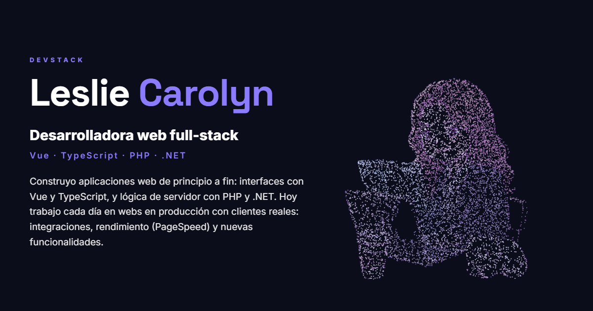

# Leslie Carolyn · DevStack Portfolio

[](https://vuejs.org/)
[](https://vitejs.dev/)
[](https://tailwindcss.com/)
[](https://threejs.org/)
[](https://github.com/lyn-devstack/lyn-portfolio/actions/workflows/deploy.yml)

Personal portfolio of **Leslie Carolyn**, full-stack web developer (Vue.js · TypeScript · PHP · .NET).

🔗 **Live site:** https://lyn-devstack.github.io/lyn-portfolio/



## Features

- **Bilingual (ES / EN)** with `vue-i18n`; the `<html lang>` attribute follows the selected language.
- **Two themes**: dark (indigo accent) and light (coral accent), built on CSS custom properties.
- **Morphing 3D particles** with Three.js: 9,000 particles form an illustrated avatar in the hero, flow into a wave through the middle sections and become an envelope at the contact section, with a staggered transition driven by scroll and a mouse-repel effect. The avatar point cloud is precomputed from an illustration (`public/particles/avatar.bin`). Lazy-loaded, and static when the OS asks for reduced motion.
- **Data-driven project cards** with links to code and live demos, plus a detail modal (architecture diagram, challenge, stack). The modal closes with `Esc`.
- **Experience timeline, skills and downloadable CV** in both languages.
- **SEO & social sharing**: meta description and Open Graph image.
- **Automatic deployment** to GitHub Pages on every push to `main`.

## Tech stack

| Area | Tools |
|---|---|
| Framework | Vue 3 (Composition API, `<script setup>`) |
| Build | Vite 5 |
| Styling | Tailwind CSS 4 + scoped CSS with theme variables · Space Grotesk + Inter |
| 3D | Three.js |
| i18n | vue-i18n 11 |
| CI/CD | GitHub Actions → GitHub Pages |

## Getting started

Requirements: Node.js 18+.

```bash
npm install
npm run dev       # development server at http://localhost:5173/lyn-portfolio/
npm run build     # production build in dist/
npm run preview   # serve the production build locally
```

## Project structure

```
src/
├── App.vue                  # layout, navigation, theme and language switch
├── style.css                # global styles and theme variables (.pro / .creative)
├── i18n.js                  # vue-i18n setup
├── locales/                 # es.json / en.json: all site texts
├── data/projects.js         # project list (stack, images, links)
└── components/
    ├── LogicCore.vue        # Three.js background
    ├── ProjectCard.vue      # project card + detail modal
    └── sections/            # Hero, Experience, Projects, Skills, Contact
public/
├── images/                  # screenshots, diagrams, Open Graph image
└── cv/                      # public CV (ES / EN)
scripts/make_cv.py           # generates the CV as HTML, to print to PDF
```

### Adding a project

1. Add an entry to `src/data/projects.js` (`id`, `title`, `stack`, `image`, `repo`, `demo`…).
2. Add its texts under `projects.<id>` in `src/locales/es.json` and `src/locales/en.json`.
3. Put its screenshot in `public/images/`.

## Contact

- LinkedIn: [linkedin.com/in/carolyn-lyn-dev](https://www.linkedin.com/in/carolyn-lyn-dev)
- GitHub: [@lyn-devstack](https://github.com/lyn-devstack)
